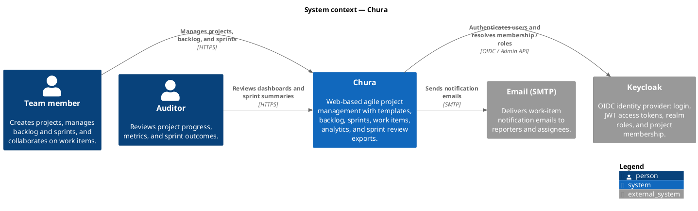

# C1 — System context

Chura helps student teams run Agile projects (backlog, sprints, work items, reviews) while auditors inspect progress. Authentication and project membership are delegated to Keycloak; work-item notifications use email.

## Notes

- End users interact only with the Chura UI and API; they do not log into Postgres, MongoDB, or RabbitMQ directly.
- Keycloak runs as a separate Compose stack (`deploy/docker-compose.identity.yml`) but is a hard dependency for every protected API call.
- SMTP is optional in local dev but required for the RabbitMQ notification consumer in integrated environments (`backend/README.md`).
