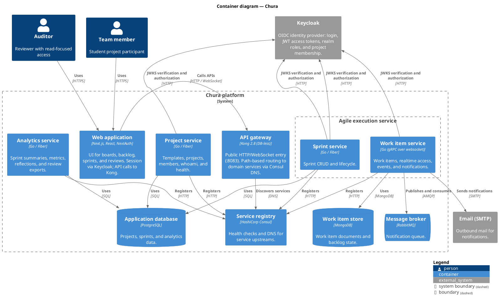

# C2 — Containers

Local and Docker deployments expose a single HTTP entry on Kong (`:8083`). Domain services register with Consul; Kong resolves `*.service.consul` and routes by path (`deploy/kong/kong.yml`). The Next.js frontend talks to Kong and Keycloak; it proxies some API calls through Next.js route handlers.

Kong discovers backend services through Consul rather than depending on each
service as a separately configured route. Keycloak is intentionally omitted
from this container view for readability. It remains a cross-cutting
dependency: the web application uses OIDC, backend services validate JWTs
with its JWKS endpoint, and project-related operations use its Admin API for
membership and roles. Keycloak persists its realm data in a separate
PostgreSQL container (`deploy/docker-compose.identity.yml` →
`keycloak-db`).

## Routing reference (Kong → service)

| Path prefix / pattern                                                | Upstream (Consul name) | Port |
| -------------------------------------------------------------------- | ---------------------- | ---- |
| `/api/v1/templates`, `/api/v1/projects`, `/api/v1/whoami`, `/health` | `chura-project`        | 8059 |
| `/api/v1/sprints`                                                    | `chura-sprint`         | 8057 |
| Work-item HTTP + `/ws/work-items`                                    | `chura-workitem`       | 8058 |
| Sprint analytics, reflections, review exports                        | `chura-analytics`      | 8056 |

## Dev-only containers (omitted from diagram)

| Container                    | Role                                                |
| ---------------------------- | --------------------------------------------------- |
| Konga                        | Read-only Kong dashboard (`:1338`)                  |
| mongo-express                | MongoDB admin UI (`:8081`)                          |
| `agile-execution-migrations` | One-shot goose migrations before API services start |

## Alternate layout

`make backend-split` runs the four Go services on the host without Kong; the frontend still targets the same API base URL when Kong is on `:8083`.
